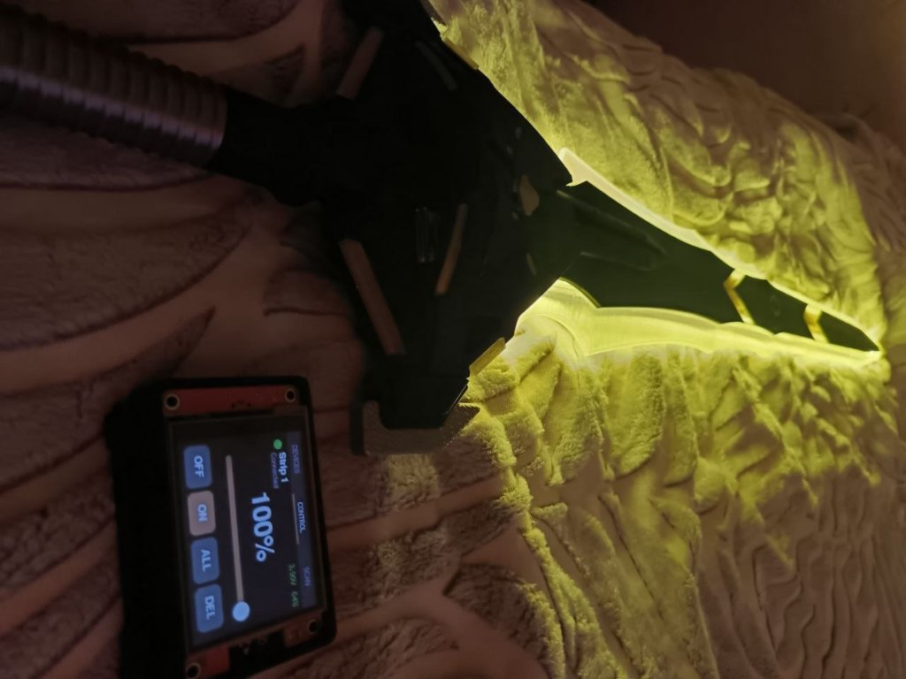

<p align="right">
  <a href="./README.md"></a>
  <a href="./README.ru.md"></a>
</p>

<p align="center">
  
</p>

<p align="center">
  
  
  
  
</p>

<p align="center">
  
</p>

<p align="center">
  
</p>

## ◆ What's here

My BLE lighting setup for cosplay props. One touchscreen remote controls all my lit swords, or I can just connect to any sword from my phone.

- **[`cyd_remote/cyd_remote.ino`](./cyd_remote/cyd_remote.ino)** — remote firmware for **ESP32-2432S028R (CYD)** 2.8" screen. Pairs with up to 3 BLE dimmers, shows live Li-Ion voltage/%, and runs 12 effects at 15–20 Hz.
- **[`led_dimmer_c3/led_dimmer_c3.ino`](./led_dimmer_c3/led_dimmer_c3.ino)** — receiver for **ESP32-C3 SuperMini** inside the hilt. Drives a 5V LED strip via **IRLB8721** MOSFET (5 kHz 10-bit PWM, gamma 2.2) and sends battery voltage every 5s. Works with **Serial Bluetooth Terminal** on Android too (`0..100`, `on`, `off`, `?`).

---

## ◆ Tabs & Effects

- **DEVICES** — saved strips, connection dot, battery voltage/%, current level or FX.
- **CONTROL** — brightness slider (`0–100%`), `OFF`, `ON`, `ALL` (sync all connected), `DEL` (double-tap `SURE?`).
- **FX** — `STATIC`, `BREATHE`, `HEART`, `FLICKER`, `STROBE` (max 5 Hz), `FADE`, `IGNITE`, `RETRACT`, `GLITCH`, `ERROR`, `BROWNOUT`, `SPARK` + speed slider (`1–10`).
- **SCAN** — find nearby `LED-Dimmer` boards and save them to flash.

---

## ◆ Receiver Wiring (ESP32-C3 SuperMini + IRLB8721)

```text
LED MOSFET:
  GPIO0 -> 220R -> IRLB8721 Gate (10k pull-down to GND)
  Source -> GND (common with ESP32, battery, LED supply)
  Drain  -> LED strip (-)
  +5V    -> LED strip (+)

Battery divider:
  BAT+ -> 100k -> GPIO1 -> 100k -> GND (+ 100nF cap GPIO1 to GND)
```

---

## ◆ Flashing (Arduino IDE)

**CYD Remote:**
- Library: `LovyanGFX` (BLE & `Preferences` are built-in)
- Board: `ESP32 Dev Module`, Partition: `Huge APP (3MB No OTA/1MB SPIFFS)`
- Set `PANEL_ST7789` to `0` (ILI9341, 1 USB) or `1` (ST7789, 2 USB) at the top of the sketch.
- Hold screen on boot to recalibrate touch.

**ESP32-C3 Receiver:**
- Board: `ESP32C3 Dev Module` (`esp32` 3.x), `USB CDC On Boot: Enabled` if you want Serial Monitor.

---

## ◆ BLE Protocol (Nordic UART)

- Service: `6E400001-B5A3-F393-E0A9-E50E24DCCA9E`
- RX (write): `6E400002-B5A3-F393-E0A9-E50E24DCCA9E` — `0`..`100`, `on`, `off`, `?`
- TX (notify): `6E400003-B5A3-F393-E0A9-E50E24DCCA9E` — `Battery: 3.99 V (64%), light: 100%`

<details>
  <summary align="center"><sub>◆ <em>[ FX #13 ]</em> ◆</sub></summary>
  <p align="center">
    <sub><code>FX_TOUCH_GRASS</code> — not enough RAM, maybe in v2.</sub>
  </p>
</details>
