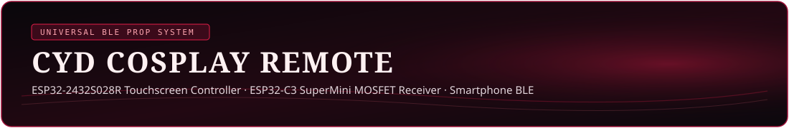
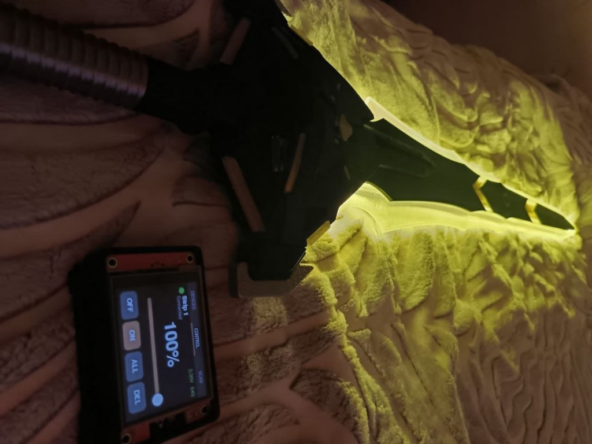

<p align="right">
  <a href="./README.md"></a>
  <a href="./README.ru.md"></a>
</p>

<p align="center">
  
</p>

<p align="center">
  <strong>Универсальная беспроводная BLE-система подсветки для косплей-оружия: один сенсорный пульт CYD (или смартфон) управляет всеми светящимися мечами.</strong>
</p>

<p align="center">
  
  
  
  
</p>

<p align="center">
  
</p>

<p align="center">
  
</p>

---

## ◆ Что внутри репозитория

1. **[`cyd_remote/cyd_remote.ino`](./cyd_remote/cyd_remote.ino)** — **Универсальный пульт**
   - Работает на **ESP32-2432S028R ("Cheap Yellow Display" / CYD)** с сенсорным экраном 2.8" 240×320.
   - Управляет одновременно до **3 BLE-мечами/лентами**, показывает точный заряд Li-Ion и крутит **12 эффектов в реальном времени** (15–20 Гц).
2. **[`led_dimmer_c3/led_dimmer_c3.ino`](./led_dimmer_c3/led_dimmer_c3.ino)** — **Приёмник в мече**
   - Работает на миниатюрной **ESP32-C3 SuperMini** внутри рукояти.
   - Управляет 5В LED-лентой через **N-канальный MOSFET IRLB8721** (ШИМ 5 кГц, 10 бит, гамма-коррекция `2.2`) и отправляет заряд батареи каждые 5 секунд.
   - Работает и напрямую со смартфона через **Serial Bluetooth Terminal** (Kai Morich) в режиме BLE (`0..100`, `on`, `off`, `?`).

---

## ◆ 4 вкладки пульта и 12 эффектов

- **DEVICES:** список сохранённых мечей, статус подключения, напряжение и % батареи, текущая яркость/эффект.
- **CONTROL:** слайдер яркости `0–100%`, кнопки `OFF`, `ON`, `ALL` (синхронизация всех подключённых устройств), `DEL` (двойное подтверждение `SURE?`).
- **FX:** 12 режимов (`STATIC`, `BREATHE`, `HEART`, `FLICKER`, `STROBE` до 5 Гц, `FADE`, `IGNITE`, `RETRACT`, `GLITCH`, `ERROR`, `BROWNOUT`, `SPARK`) + слайдер скорости `1–10`.
- **SCAN:** поиск ближайших устройств `"LED-Dimmer"` и сохранение в память NVS.

---

## ◆ Схема подключения приёмника (ESP32-C3 SuperMini + IRLB8721)

```text
Силовая часть LED (MOSFET по минусу):
  ESP32-C3 GPIO0 ──[ 220 Ом ]──► Gate (IRLB8721)
                                   │
                               [ 10 кОм ] (подтяжка к GND)
                                   │
                                  GND
  MOSFET Source ───────────────► GND (общий с ESP32, АКБ и лентой)
  MOSFET Drain  ───────────────► Минус ленты (-)
  +5V           ───────────────► Плюс ленты (+)

Измерение заряда АКБ (делитель 1:1):
  BAT+ ──[ 100 кОм ]──┬──► ESP32-C3 GPIO1 (ADC1)
                      │
                  [ 100 кОм ] + [ 100 нФ параллельно ]
                      │
                     GND
```

---

## ◆ Прошивка в Arduino IDE

- **CYD Remote:** библиотека `LovyanGFX`, плата `ESP32 Dev Module`, Partition Scheme: `Huge APP (3MB No OTA/1MB SPIFFS)`. Для повторной калибровки тача зажми экран при включении.
- **ESP32-C3 Receiver:** плата `ESP32C3 Dev Module` (`esp32` 3.x), `USB CDC On Boot: Enabled` для Serial Monitor.

<details>
  <summary align="center"><sub>◆ <em>[ Секретный эффект #13 — Заметки разработчика ]</em> ◆</sub></summary>
  <p align="center">
    <sub>Режим <code>FX_TOUCH_GRASS</code> планировался в v2.0, но Bluedroid съел всю оперативку раньше, чем я вышел из мастерской.</sub>
  </p>
</details>
